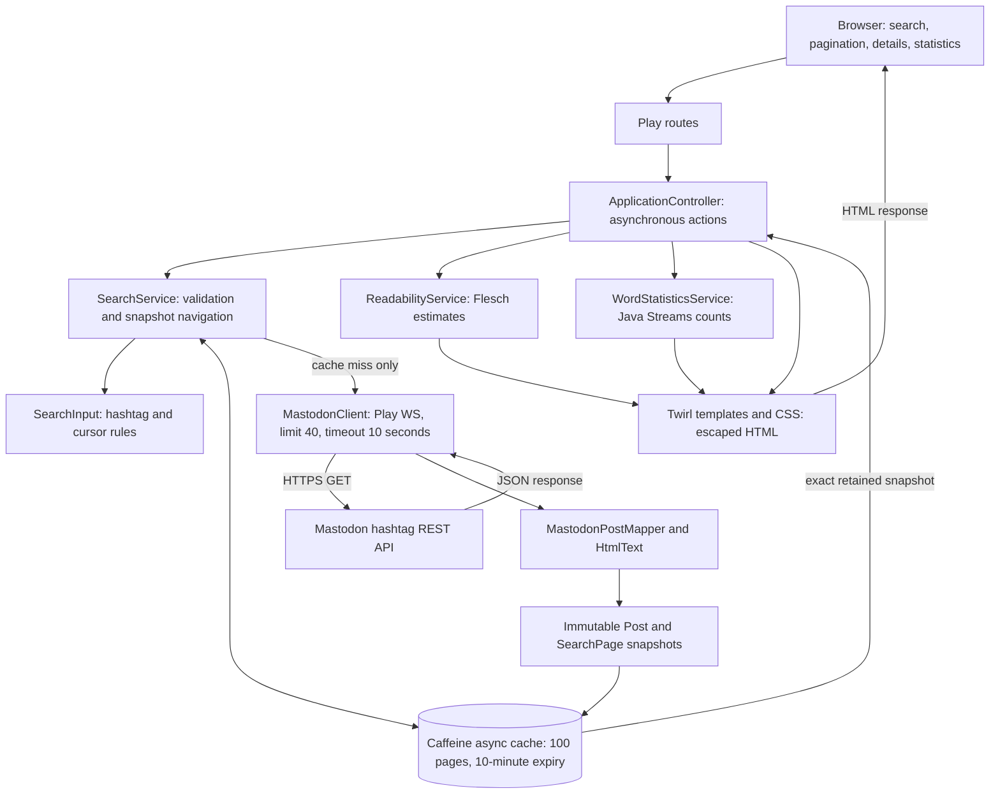

# Architecture overview

MAWA uses one Java Play application controller, server-rendered Twirl pages,
a nonblocking REST adapter, and an in-memory page cache. This diagram represents
the implemented Delivery 1 application.

## Responsibilities

| Component | Responsibility |
| --- | --- |
| `ApplicationController` | Bind routes, compose asynchronous work, render views, map controlled failures to HTTP responses |
| `SearchService` and `SearchInput` | Normalize/validate searches, share loads, retain snapshots, navigate using opaque cursors |
| `MastodonClient` | Authenticate direct REST requests using external configuration; enforce request limit, timeout and safe errors |
| Mapper and text converter | Validate full responses and turn post HTML into readable text |
| Domain models | Hold immutable post metadata, snapshots, scores, and frequency results without REST dependencies |
| Analysis services | Compute from already-cached post text without HTTP calls |
| Twirl views | Display escaped values, forms, numbered navigation, analyses and errors |

## Request paths

1. **Search:** validate → cache lookup → asynchronous API request only on a miss →
   map the full response → retain the snapshot → render results and readability.
2. **Older results:** retrieve the source snapshot → use its last post ID as
   `max_id` → reuse or fetch the older page → redirect to its saved-page URL.
3. **Details or statistics:** retrieve the exact snapshot → compute locally →
   render the analysis. Expired snapshots return 410 and are never silently refetched.

The cache key is instance + normalized hashtag + cursor. Failed loads are removed;
concurrent identical queries share a pending request. Analysis is limited to the
page being viewed. Numbered navigation is display context, not a total-result count.
No database or user session is required. Restarting the app discards cached pages.

## Routes

| Method and path | Purpose |
| --- | --- |
| `GET /` | Search form |
| `GET /search?hashtag=java` | First search page |
| `GET /results/:id` | Exact saved snapshot |
| `GET /results/:id/older` | Retrieve older results and redirect |
| `GET /results/:id/posts/:postId` | One saved post and its readability |
| `GET /results/:id/words` | Word statistics for the saved page |
| `GET /assets/*file` | Play's built-in static asset handler |

Saved-page, older-page, details and statistics routes accept an optional
`pageNumber`, defaulting to 1. The application controller is the sole handwritten
controller; Play provides its own asset controller.

## Delivery 2 evolution

The current `Post` model and analyzers contain no REST response types. A future
streaming adapter can map new events into the same domain values. Subscription
lifecycle, event ordering, incremental aggregation, and browser updates would need
new components; replacing one request method alone would not provide streaming.
Immutable snapshots can continue to define a stable analysis context while a
separate live view changes. Delivery 1 implements no application actors, WebSockets,
or streaming API. Play's internal runtime is not an application actor design.

See [the detailed design](DESIGN.md) for validation, failure mapping, cache policy,
counting rules, formulas, and limitations.
